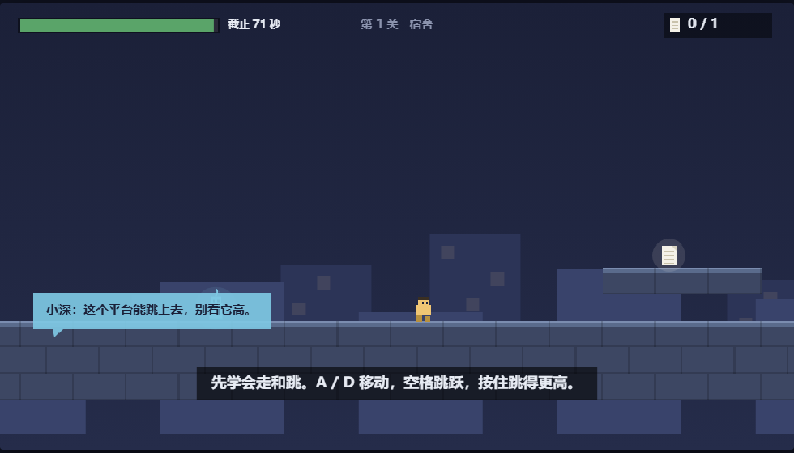
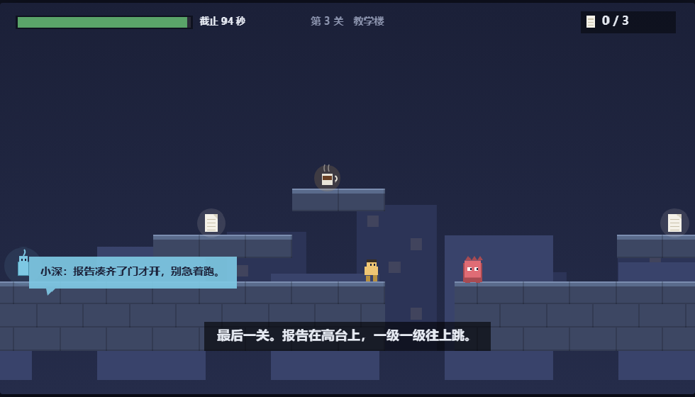

# Report Rush

**赶报告** — A pixel-art side-scrolling platformer about finishing lab reports before the deadline.

A student runs through a dormitory, a laboratory, and a teaching building, collecting every lab report before time runs out.

**Single-file HTML5. No engine, no build step, no dependencies.** Open `index.html` and play.

> ### ▶ [Play in browser](https://fyfcccjy.github.io/report-rush/)
>
> Or download [index.html](index.html) and open it locally — the game is fully offline.


## How to Play

| Action | Keys |
|---|---|
| Move | `A` / `D` or `←` `→` |
| Jump | `Space` / `W` / `↑` — hold to jump higher |
| Restart level | `R` |

Touch controls are available on mobile: two zones at the bottom left for movement, one at the bottom right for jumping.

The game has three levels. Each level scatters several lab reports across the map; **the exit only opens once all of them are collected**. Reaching the exit clears the level. The run ends if the timer reaches zero or the player falls into a pit.

Hazards and pickups:

- **Deadline creatures** patrol the ground — touching one costs 8 seconds
- **Coffee** increases movement speed for 5 seconds
- **Xiaoshen**, an NPC near each level's starting point, offers hints when approached

## Screenshots

| Level 1 — Dormitory | Level 3 — Teaching Building |
|---|---|
|  |  |

## Implementation

The game is written from scratch without any game engine or framework.

**Tile map.** Levels are described as arrays of strings, so editing a level means editing characters:

```
#  solid tile        =  one-way platform (passable from below)
P  spawn point       D  exit door
R  report            E  enemy
C  coffee            N  NPC
```

**AABB collision, resolved per axis.** Horizontal movement is resolved before vertical movement, which prevents the player from tunnelling through walls at high speed.

**Movement feel.** Three details separate a responsive platformer from a sluggish one, and all three are implemented here:

- **Variable jump height** — releasing the jump key multiplies upward velocity by 0.42, so tapping produces a short hop and holding produces a full jump
- **Coyote time** — the player may still jump for 7 frames after walking off a ledge
- **Jump buffering** — a jump pressed up to 7 frames before landing is executed on touchdown

**Parallax background.** Two layers of buildings scroll at different rates relative to the camera.

**Feedback.** Particles on pickup, screen shake on damage, and floating messages.

## Running Locally

No toolchain is required. Open `index.html` in a browser.

The `src/` directory contains the same code split into readable modules:

| File | Responsibility |
|---|---|
| `core.js` | Game logic: physics, collision, entities, state machine |
| `render.js` | Rendering: tiles, characters, UI, effects |
| `main.js` | Main loop, input handling, state transitions |
| `gen_levels.py` | Level generator with reachability checks |

After editing the modules, concatenate them back into the single-file build, or serve `src/` through a local HTTP server.

## Testing

Three automated test suites, runnable with Node:

```bash
node src/test_logic.js    # physics, collision, pickups, state machine (29 assertions)
node src/test_levels.js   # level reachability: gap widths and ledge heights
node src/test_bot.js      # a bot plays all three levels and must reach each exit
```

The third one is the most useful: a simple AI actually plays the game, and the build is only considered valid if it can finish every level.

## Development Notes

Two mistakes made during development are worth recording.

**Levels cannot be designed by eye.**

The first version used pits fourteen tiles wide. The player cannot clear them, so the game was impossible to finish. Calculating the actual jump arc showed the player rises only 104 pixels (3.28 tiles) and clears 169 pixels horizontally (5.29 tiles) — the gaps were three to four times too large.

The fix was to generate maps from a script with reachability encoded as a hard constraint: gaps no wider than three tiles, ledges no taller than two tiles. The generator rejects any map that violates these limits.

**An incorrect magic number fails silently.**

The map parser stored `row.push(TILE)` (the value 32) for solid tiles, while the collision test compared against `=== 1`. Since 32 never equals 1, no tile was ever solid: the player fell through the floor and every enemy dropped out of the world, with no error reported anywhere.

The failure was especially hard to notice because the test asserting "the player does not sink after landing" passed — the player never moved, so the position never changed. A false green is more dangerous than a red.

## License

[MIT](LICENSE) — free to use, modify, and distribute.

## Acknowledgements

Built in collaboration with an AI assistant. The level design, physics tuning, and rendering code were written and tested iteratively; the development notes above are a record of real mistakes made along the way.